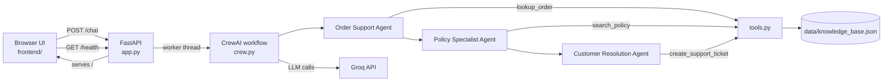
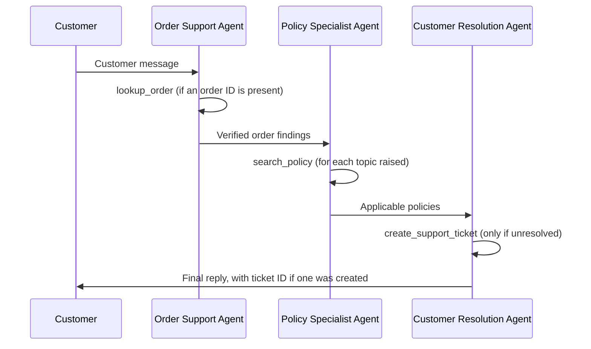

# Aria: AI Customer Support Agent

**Live demo:** https://crewai-customer-support-agent.onrender.com/
**API documentation:** https://crewai-customer-support-agent.onrender.com/docs

Aria is a customer support assistant built with CrewAI, Groq, and FastAPI. Three AI agents work in sequence to look up an order, find the matching company policy, and write a clear reply. If a problem cannot be solved automatically, Aria opens a support ticket and returns the ticket ID.

---

## Overview

Customers often ask the same questions: where is my order, can I cancel it, what is the refund policy, and what should I do about a damaged item. Answering them well requires checking order records, applying the right policy, and writing a clear reply. Aria automates these steps with a sequential multi-agent workflow and a browser chat interface.

## Problem Statement

Support teams spend much of their time answering repeated questions, and customers wait for replies. Automated answers are only useful if they are accurate, so Aria is designed to rely on verified data and to avoid inventing order details or policies.

## Objectives

- Answer order status, tracking, and delivery questions from a verified knowledge base.
- Explain refund, return, shipping, cancellation, and payment policies from the company's policy text.
- Create a support ticket with a reference ID when a problem needs human follow-up.
- Provide a responsive chat interface with clear loading and error states.

## Features

### Working now

| Feature | Description |
|---|---|
| Order lookup | Returns status, product, tracking number, delivery estimate, and amount for an order ID such as `ORD1001`. |
| Policy answers | Finds matching refund, return, shipping, cancellation, and payment policies, with eligibility and conditions. |
| Support tickets | Creates a ticket with a `TKT-` reference when a problem cannot be resolved automatically. |
| Three-agent workflow | Order, policy, and resolution agents run in sequence using CrewAI. |
| Chat interface | Responsive browser UI with suggested questions, conversation history, typing indicator, and retry on errors. |
| Formatted replies | AI replies support bold text, lists, tables, headings, and code, rendered safely without `innerHTML`. |
| Health check | `/health` reports service status and the configured model. |
| Docker packaging | Dockerfile and Docker Compose file for local containers. |

### Planned (not built yet)

- Product catalogue and live inventory checks
- Placing orders through chat
- Changing a delivery address through chat
- Cancelling an order through chat
- Database storage (SQLite, then PostgreSQL)
- Customer accounts and saved addresses
- Payments (sandbox first)
- Seller accounts
- Automated tests

## System Architecture



## Three-Agent Workflow



| Agent | Tool | Responsibility |
|---|---|---|
| Order Support Specialist | `lookup_order` | Finds the order ID, retrieves facts, and reports missing or invalid information. |
| Policy Specialist | `search_policy` | Identifies applicable policies and quotes their eligibility and conditions. |
| Customer Resolution Specialist | `create_support_ticket` | Decides whether a ticket is needed and writes the final reply. |

## Technology Stack

| Layer | Technology |
|---|---|
| Agents | CrewAI (`Agent`, `Task`, `Crew`, `Process.sequential`) |
| Language model | Groq API, default `groq/openai/gpt-oss-120b` |
| Backend | Python 3.12, FastAPI, Uvicorn, Pydantic |
| Frontend | HTML5, CSS3, vanilla JavaScript |
| Data | JSON knowledge base |
| Deployment | Docker, Docker Compose, Render |

## Project Structure

```
ai_customer_support_agent/
├── frontend/
│   ├── index.html          Page layout
│   ├── style.css           Styling
│   ├── script.js           Chat logic and API calls
│   └── markdown.js         Safe Markdown renderer for AI replies
├── data/
│   └── knowledge_base.json Orders, policies, and tickets
├── app.py                  FastAPI routes and static file serving
├── crew.py                 CrewAI agents, tasks, and crew runner
├── tools.py                Order, policy, and ticket tools
├── requirements.txt        Python dependencies
├── .env.example            Environment variable template
├── Dockerfile
├── docker-compose.yml
├── .dockerignore
└── README.md
```

## Setup (Windows PowerShell)

### 1. Open the project and activate the environment

```powershell
cd C:\Users\ADMIN\OneDrive\Documents\CrewAI_Agents\ai_customer_support_agent
..\.venv312\Scripts\activate
python --version
```

The version should be Python 3.12.x.

### 2. Install dependencies

```powershell
python -m pip install --upgrade pip
python -m pip install -r requirements.txt
```

### 3. Create the environment file

```powershell
Copy-Item .env.example .env
notepad .env
```

Replace `your_groq_api_key_here` with your Groq API key. Keep `.env` in the project root and never commit it.

### 4. Start the server

```powershell
python -m uvicorn app:app --reload
```

Open http://127.0.0.1:8000 in your browser.

## Environment Variables

| Variable | Required | Default | Purpose |
|---|---|---|---|
| `GROQ_API_KEY` | Yes | None | Groq API key. Used only on the server. |
| `MODEL_NAME` | No | `groq/openai/gpt-oss-120b` | Model used by the agents. |
| `APP_HOST` | No | `127.0.0.1` | Host when running `app.py` directly. |
| `APP_PORT` | No | `8000` | Port when running `app.py` directly. |
| `DEBUG` | No | `false` | Verbose logs and detailed error messages. |
| `CREW_TIMEOUT_SECONDS` | No | `120` | Maximum time for one chat request. |
| `CORS_ORIGINS` | No | Local origins | Comma-separated list of allowed browser origins. |

## Using the Chat Interface

- Click a suggested question, or type your own and press **Enter**.
- Press **Shift + Enter** for a new line.
- The status indicator shows whether the assistant is online.
- Use **New conversation** to start over. Past conversations are stored in your browser.
- If a request fails, use **Retry** in the error message.

## Sample Queries

These work with the sample data in `data/knowledge_base.json`:

- "Where is my order ORD1001?"
- "Has order ORD1004 been delivered yet?"
- "Can I cancel my order ORD1003?"
- "What is your refund policy for a damaged item?"
- "I was charged twice for ORD1006. What should I do?"
- "How long does standard shipping take?"
- "My order ORD1002 arrived damaged." (creates a support ticket)

## API Reference

### `GET /health`

```json
{ "status": "ok", "version": "1.0.0", "model": "groq/openai/gpt-oss-120b" }
```

### `POST /chat`

Request:

```json
{ "message": "Where is my order ORD1001?" }
```

Response (`200 OK`):

```json
{ "answer": "Your order ORD1001 for the Wireless Noise-Cancelling Headphones has shipped..." }
```

| Status | Meaning |
|---|---|
| 400 | Message is blank or longer than 2000 characters |
| 422 | Request body failed validation |
| 503 | The assistant is unavailable (for example, the API key is missing) |
| 504 | The assistant did not respond within `CREW_TIMEOUT_SECONDS` |
| 500 | Unexpected server error |

Interactive documentation is available at `/docs` when the server is running.

## Docker

Docker Desktop must be running.

```powershell
docker compose up --build -d
```

Open http://localhost:8000. To stop the container:

```powershell
docker compose down
```

## Deployment on Render

The live demo runs on Render's free tier.

1. Create a **Web Service** and connect this GitHub repository.
2. Choose **Docker** as the environment.
3. In **Environment**, add:
   - `GROQ_API_KEY`: your Groq API key
   - `MODEL_NAME`: `groq/openai/gpt-oss-120b` (optional, this is the default)
4. Make sure the container starts on the port Render provides. The `Dockerfile` should end with:

   ```dockerfile
   CMD ["sh", "-c", "uvicorn app:app --host 0.0.0.0 --port ${PORT:-8000}"]
   ```

Notes for the free tier:

- The service sleeps after a period of inactivity, so the first request can take a while.
- The disk is reset on every restart or redeploy, so **support tickets created on Render are not kept permanently**. Use a database or a persistent disk before relying on tickets.

## Knowledge Base

`data/knowledge_base.json` has three sections:

| Section | Fields |
|---|---|
| `orders` | `order_id`, `customer_name`, `product_name`, `order_status`, `tracking_id`, `estimated_delivery`, `amount` |
| `policies` | `policy_id`, `topic`, `title`, `content`, `eligibility`, `conditions` |
| `tickets` | `ticket_id`, `issue`, `customer_message`, `status`, `created_at` (added automatically) |

Policy topics are `refund`, `return`, `shipping`, `cancellation`, and `payment`. All sample data is fictional, and amounts have no currency code.

To check the file after editing:

```powershell
python -m json.tool data/knowledge_base.json
```

The tools read the file on every request, so you do not need to restart the server after changing data.

## Testing

Automated tests are not written yet. To test manually:

1. Check the tools without an API key:
   ```powershell
   python -c "from tools import find_order, search_policies; print(find_order('ORD1001')); print(search_policies('refund for damaged item'))"
   ```
2. Test the agents in the terminal: `python crew.py`
3. Test the full app in the browser, using the sample queries above.

## Roadmap

1. Product catalogue and inventory with a product search tool
2. Order placement through chat, with a confirmation step
3. Address change and cancellation tools that follow the policy rules
4. Database storage (SQLite, then PostgreSQL)
5. Customer accounts and saved addresses
6. Automated tests for the tools and the API
7. Sandbox payments, then live payments and shipping integration

## Security

- The Groq API key is read on the server and is never sent to the browser.
- AI replies are rendered with `createElement` and `textContent`, never `innerHTML`.
- Links in AI replies must start with `http://` or `https://`.
- Customer messages are limited to 2000 characters and validated by Pydantic.
- The Docker image runs as a non-root user and excludes `.env`.
- Ticket writes are atomic, so a crash does not leave the JSON file half-written.

## Known Limitations

- Order lookups do not verify the customer's identity. Add authentication before using real customer data.
- Policy search is keyword-based, so unusual wording may not match a policy.
- Tickets are stored in a JSON file. This is fine for a demo but not for multiple servers or permanent storage.
- Each reply is generated from the current message only. Follow-up questions do not yet use earlier messages.
- Conversation history is stored in the browser only and is not shared across devices.
