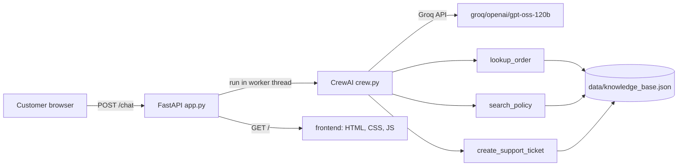
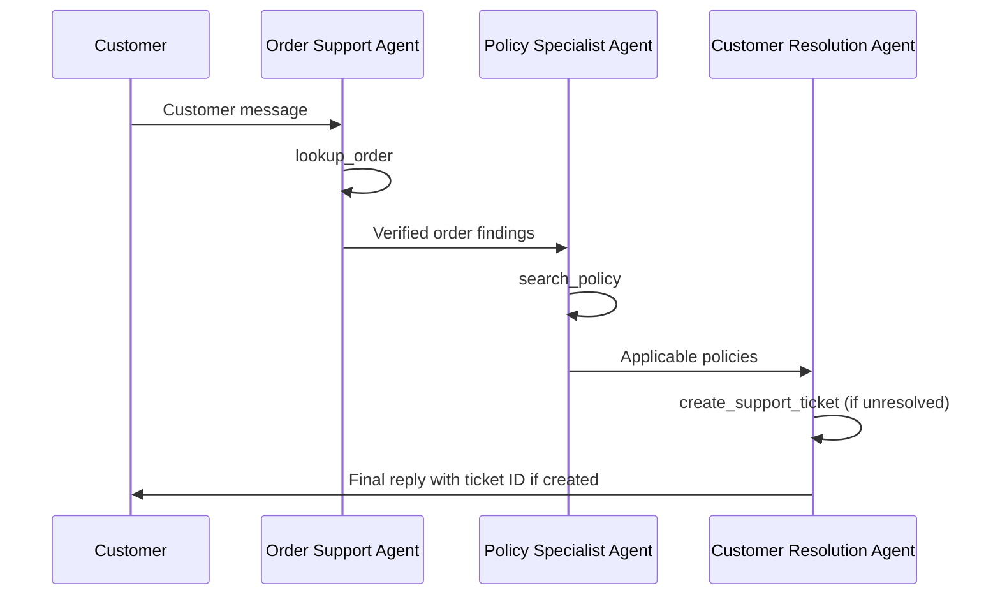

# SupportDesk AI: Customer Support Agent

A customer support assistant built with **CrewAI**, **Groq** and **FastAPI**. Three specialised agents work in sequence to look up orders, check company policies and reply to the customer. Unresolved problems become support tickets.

## Overview

Customers ask questions like "Where is my order?" or "Can I get a refund?". Answering well means checking order records, applying the right policy and writing a clear reply. This project handles all three steps with a sequential multi-agent workflow and serves the result through a browser chat interface.

## Problem Statement

Support teams answer the same questions repeatedly, and customers wait for replies. Automated answers are only useful when they are accurate, so the system must use real data and must not invent order details or policies.

## Objectives

- Answer order status, tracking and delivery questions from a verified knowledge base.
- Explain refund, return, shipping, cancellation and payment policies from source text.
- Create a support ticket with a reference number when a problem needs human follow-up.
- Provide a responsive chat interface with clear loading and error states.

## System Architecture



## Three-Agent CrewAI Workflow



## Technology Stack

| Layer | Technology |
|---|---|
| Agents | CrewAI (Agent, Task, Crew, Process.sequential) |
| LLM | Groq API, `groq/openai/gpt-oss-120b` |
| Backend | Python 3.12, FastAPI, Uvicorn, Pydantic |
| Frontend | HTML5, CSS3, vanilla JavaScript |
| Data | JSON knowledge base |
| Deployment | Docker, Docker Compose |

## Project Structure

```
ai_customer_support_agent/
├── frontend/           index.html, style.css, script.js
├── data/               knowledge_base.json
├── app.py              FastAPI routes and static file serving
├── crew.py             Three-agent CrewAI workflow
├── tools.py            lookup_order, search_policy, create_support_ticket
├── requirements.txt
├── .env.example
├── Dockerfile
├── docker-compose.yml
├── .dockerignore
└── README.md
```

## Python 3.12 Virtual Environment Setup

```powershell
cd C:\Users\ADMIN\OneDrive\Documents\CrewAI_Agents\ai_customer_support_agent
.venv312\Scripts\activate
python --version
```

## Dependency Installation

```powershell
python -m pip install --upgrade pip
python -m pip install -r requirements.txt
```

## Groq API Key Configuration

1. Create a key at the Groq console.
2. Copy `.env.example` to `.env`.
3. Replace `your_groq_api_key_here` with your key.

Keep `.env` out of version control. It is excluded from Docker builds.

## Running the Application

```powershell
python -m uvicorn app:app --reload
```

Open http://127.0.0.1:8000 in your browser. API documentation is available at http://127.0.0.1:8000/docs.

## Browser Interface

- Click a suggested question, or type your own and press **Enter**.
- Press **Shift + Enter** for a new line.
- A typing indicator shows while the agents work.
- Use **New conversation** to start over. Past conversations are saved in your browser and can be reopened from the sidebar.
- If a request fails, use **Retry** in the error banner.

## Sample Customer Queries

- "Where is my order ORD1001?"
- "Has order ORD1004 been delivered yet?"
- "Can I cancel my order ORD1003?"
- "What is your refund policy for a damaged item? Order ORD1002."
- "I was charged twice for ORD1006. What should I do?"
- "How long does standard shipping take?"

## API Endpoint Documentation

### `GET /health`

```json
{ "status": "ok", "version": "1.0.0", "model": "groq/openai/gpt-oss-120b" }
```

### `POST /chat`

Request:

```json
{ "message": "Where is my order ORD1001?" }
```

Response (`200 OK`):

```json
{ "answer": "Your order ORD1001 for the Wireless Noise-Cancelling Headphones is currently shipped..." }
```

Error codes:

| Status | Meaning |
|---|---|
| 400 | Message is empty or too long |
| 422 | Request body failed validation |
| 503 | The support assistant is unavailable (for example, a missing API key) |
| 504 | The assistant did not respond within `CREW_TIMEOUT_SECONDS` |

## Docker Deployment

```powershell
docker compose up --build -d
```

Open http://localhost:8000. The `data` folder is mounted as a volume, so tickets persist after the container restarts. Docker Desktop must be running.

## Knowledge Base Configuration

`data/knowledge_base.json` has three sections:

- **orders**: `order_id`, `customer_name`, `product_name`, `order_status`, `tracking_id`, `estimated_delivery`, `amount`
- **policies**: `policy_id`, `topic` (`refund`, `return`, `shipping`, `cancellation` or `payment`), `title`, `content`, `eligibility`, `conditions`
- **tickets**: created automatically by the app with `ticket_id`, `issue`, `customer_message`, `status`, `created_at`

Add orders or policies by editing the JSON file. The sample data is fictional. Amounts are plain numbers, and the currency is not stored.

## Future Enhancements

- Connect `lookup_order` to a live order management system instead of a JSON file.
- Pass earlier messages in a conversation to the agents so follow-up questions have context.
- Add authentication so customers can only see their own orders.
- Add a database for tickets and an admin view for support staff.
- Add automated tests for the tools and the API.

## Security Considerations

- The Groq API key is read from `.env` on the server and is never sent to the browser.
- Responses are rendered as plain text in the frontend, which prevents script injection from AI output.
- Customer input is limited to 2,000 characters and validated by Pydantic.
- The Docker image runs as a non-root user and does not include `.env` or virtual environments.
- Ticket writes are atomic, so a crash does not corrupt `knowledge_base.json`.
- Order lookups currently do not check customer identity. Add authentication before using real customer data.